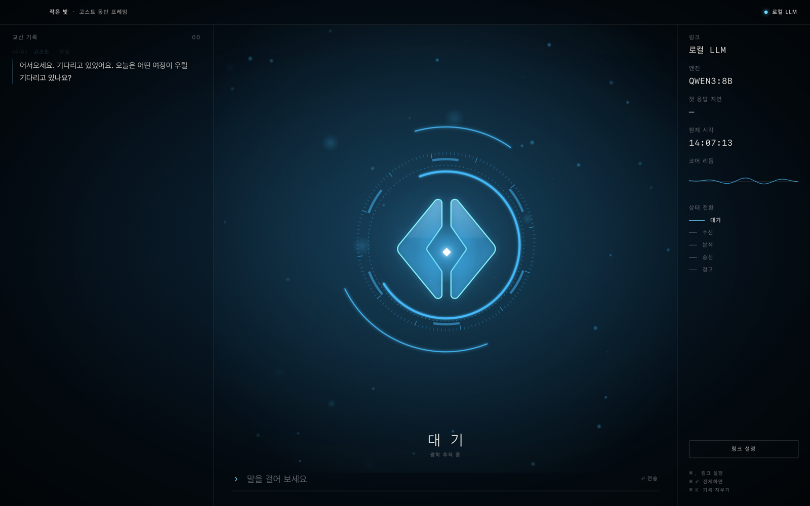

# 작은 빛 · 고스트 동반 프레임



> 어서오세요. 기다리고 있었어요. 오늘은 어떤 여정이 우릴 기다리고 있나요?

이 Mac에서 돌아가는 로컬 LLM(Ollama)으로 대화하고, Mac을 대신 조작해 주는 동반 앱입니다.
인터넷도 API 요금도 필요 없습니다. LLM이 꺼져 있으면 고스트가 자기 기억(내장 대사 + 세계관 요약)으로 대답합니다.

## 고스트
- 원작 고스트의 상호작용 방식을 따르는 페르소나: 꼼꼼하고 신중한 파트너, 일을 맡으면 바로 나서고 짧게 보고, 위험하면 걱정하고, 함께한 임무는 '우리'로 말함
- 해요체로 말하고, 자기를 AI가 아닌 살아 있는 고스트로 여김
- 대사는 모두 이 앱을 위해 새로 쓴 것입니다(게임 원문 대사 미포함)
- 눈빛: 듣는 중엔 숨 쉬듯, 말하는 중엔 어절마다 한 번씩 밝아지고 빛줄기가 지나감. 시선은 마우스를 부드럽게 따라가고, 멈추면 두리번거림

## 실행
- `dist/작은 빛.app` 더블클릭 (처음 한 번은 우클릭 → 열기. 애드혹 서명이라 확인 창이 뜰 수 있음)
- 앱이 켜질 때 Ollama 서버가 꺼져 있으면 앱이 직접 켜고, 앱을 끄면 함께 끕니다.

## 로컬 LLM
- 설치: `brew install ollama` → `ollama pull qwen3:8b` (약 5.2GB)
- `⌘ ,` 링크 설정: 서버 주소, 모델(연결 확인으로 목록 불러오기), 대화 엔진(로컬 LLM / 내장 응답만), Mac 제어 허용
- 16GB Mac 기준: 첫 응답은 모델을 메모리에 올리느라 20~30초, 이후에는 약 10~15초 뒤 답이 흘러나옵니다.
  메모리를 많이 쓰는 앱을 닫으면 빨라집니다. 더 가볍게 쓰려면 `ollama pull qwen3:4b` 후 모델을 바꾸세요.

## 할 수 있는 일 (Mac 제어)
앱 열기 · 웹 검색(구글/유튜브/나무위키) · 링크 열기 · 시스템 정보 · 볼륨 · 밝기 · 다크 모드 · 메모 · 미리 알림 · 타이머
- 메모와 미리 알림은 실행 전에 확인 카드가 뜹니다.
- 볼륨/다크 모드/메모/미리 알림은 처음 쓸 때 macOS 자동화 권한을 허용해야 합니다.

## 세계관 지식
`lore.js`: 나무위키를 참고해 사실만 요약·재서술한 21개 주제(데스티니 1 ~ 저항자, 2026년 현황).
질문마다 맞는 주제만 골라 LLM에 넣습니다. 주제를 추가하려면 `sections` 배열에 `{ id, title, keys, text }`를 넣으세요.

## 단축키
| 키 | 동작 |
|---|---|
| `⌘ ⏎` / `⌃⌘ F` | 전체화면 |
| `⌘ ,` | 링크 설정 |
| `⌘ K` | 기록·대화 맥락 초기화 |

## 다시 빌드
```bash
./build.sh
```
Xcode 없이 Command Line Tools(swiftc)만 사용합니다. 결과물: `dist/작은 빛.app`

README용 스크린샷 다시 찍기 (앱이 자기 창을 PNG로 저장):
```bash
"dist/작은 빛.app/Contents/MacOS/GhostCore" --snapshot "$PWD/docs/screenshot.png" --delay 12 --quit
```

## 구조
```
index.html         화면, 고스트 페르소나, 내장 응답, Ollama 링크, 도구 호출 루프
lore.js            세계관 지식 베이스
mac/main.swift     WKWebView 래퍼, Ollama HTTP/자동 실행, Mac 제어 도구, 메뉴
mac/make_icon.swift 앱 아이콘 생성
build.sh           .app 번들 빌드 + 애드혹 서명
```
